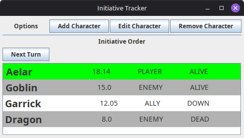
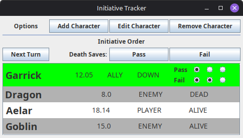

# D&D Initiative Tracker

A desktop combat initiative tracking application built with Java and Swing. It streamlines encounter management for Dungeon Masters and tabletop RPG players by automating descending turn order calculations, dynamically breaking initiative ties via dexterity tie-breakers, handling cyclical combat rounds, and visually tracking death saving throws in real time.

---

##  Interface Preview

### Standard Combat View
The active combatant is dynamically highlighted in green at the top of the initiative order, displaying their base roll, entity type, and current status:



### Downed Combatant & Death Saves View
When a combatant with the `DOWN` status takes their turn, dedicated **Pass** and **Fail** controls activate alongside a 6-circle visual indicator tracking accumulated death saves:



---

## Features

### 1. Dynamic Initiative Sorting & Tie-Breaking
* Automatically sorts combatants in descending initiative order.
* Computes composite initiative using the base rolled score plus the character's dexterity score divided by 100:
  $$\text{Composite Initiative} = \text{Base Initiative} + \left(\frac{\text{Dexterity}}{100}\right)$$
  For example, a character rolling $15$ with $14$ Dexterity yields an initiative score of $15.14$, automatically winning a tie-breaker over a character rolling $15$ with $10$ Dexterity ($15.10$).
* Monster and non-player enemy entities omit the fractional dexterity modifier by default to keep monster rolls flat.

### 2. Cyclical Round Progression
* The combatant currently taking their turn is pinned to index `0` and highlighted in bright green.
* Clicking **Next Turn** smoothly advances the active combatant and rotates the initiative queue without destroying the underlying initiative values.

### 3. Integrated Death Save Tracker
* When a downed character (`DOWN`) reaches the top of the turn queue, interactive **Pass** and **Fail** buttons appear in the main toolbar.
* Two rows of radio-style indicators visually stamp up to 3 passes and 3 failures directly inside the active character cell.
* **Automated Life Status Transitions:**
  * **3 Passes:** The character stabilizes, status reverts to `ALIVE`, and save tallies automatically reset to zero.
  * **3 Fails:** The character succumbs, status changes to `DEAD`, and save tallies automatically reset to zero.
  * Manual status changes away from `DOWN` automatically clear residual death save counters.

### 4. Character Roster Management
* **Add Character:** Modal dialog featuring name validation that prevents duplicate entries. Allows configuring display name, base initiative, dexterity ($0$–$30$), category (`PLAYER`, `ENEMY`, `ALLY`), and initial status (`ALIVE`, `DEAD`, `DOWN`).
* **Edit Character:** Dedicated editor dialog enabling real-time adjustments to initiative, dexterity, or life status mid-encounter.
* **Remove Character:** Allows single-target removal of fallen enemies or complete table wipes between encounters.

---

##  Architecture & Project Structure

```text
com.eubi.initiativetracker
├── Main.java                          # Application entry point and EDT initialization
├── characters
│   ├── Character.java                 # Entity domain model, stat calculations, and save tallies
│   ├── CharacterManager.java          # Combat queue manager, sorting algorithms, and turn cycling
│   ├── CharacterType.java             # Enum: PLAYER, ENEMY, ALLY, UNKNOWN
│   └── DeathStatus.java               # Enum: ALIVE, DEAD, DOWN, UNKNOWN
└── swingui
    ├── MainMenu.java / .form          # Master JFrame view built with IntelliJ GUI Designer
    ├── UIManager.java                 # Controller mediating between CharacterManager and Swing views
    ├── CharacterCellRenderer.java     # Custom rubber-stamp ListCellRenderer with death save indicators
    ├── AddCharacterMenu.java          # Modal JDialog for character creation and validation
    ├── EditCharacterMenu.java         # Modal JDialog for modifying combatant attributes
    └── RemoveCharacterMenu.java       # Modal JDialog for pruning combatants