# D&D Initiative Tracker


A desktop combat management and initiative tracking application for D&D. Designed for Dungeon Masters, it automates turn order, resolves ties, tracks NPC hit points, manages swarms and hordes, handles death saves, and provides secure encrypted encounter saves.

## Table of Contents
- [Installation & Running](#installation--running)
- [Features](#features)
- [Usage Guide](#usage-guide)
- [Project Structure](#project-structure)
- [Authors](#authors)
- [License](#license)

---

## Installation & Running

### Via Repository

#### Prerequisites
Ensure you have the following installed on your machine:
- **Java Development Kit (JDK):** Version 21 or higher: `java -version`
- **Apache Maven:** `mvn -version`
- **Git:** `git --version`

#### 1. Clone the repository

**Windows:**
```shell
cd C:/Users/YourUsername/Documents/
git clone https://github.com/C0d3Wan/InitiativeTracker
cd C:/Users/YourUsername/Documents/InitiativeTracker/
```

**Linux:**
```bash
cd ~/Documents/
git clone https://github.com/C0d3Wan/InitiativeTracker
cd ./InitiativeTracker/
```

#### 2. Compile and run using Maven

Run directly via Maven:
```bash
mvn clean compile exec:java -Dexec.mainClass="com.c0d3wan.initiativetracker.Main"
```

Or build the package and run it from the `target/` directory:
```bash
mvn clean package
java -jar target/initiativetracker-<version>.jar
```

To supply a custom 256-bit AES Base64 key for file encryption:
```bash
java -Dsave.encryption.key="YOUR_BASE64_AES_KEY" -jar target/initiativetracker-<version>.jar
```

### Via Releases
Go to [Releases](https://github.com/C0d3Wan/InitiativeTracker/releases) and install the latest version for your device.

---

## Features
- **Automatic Initiative & Dynamic Tie-Breaker Calculation** – Sorts combatants automatically in descending order, using Dexterity scores as fractional tie-breakers for Players and Allies while keeping Enemy rolls standard.
- **Circular Turn Queue & Active Highlighting** – Cyclically advances combat round-by-round, anchoring the active combatant at index 0 with an emerald green highlight and skipping deceased combatants automatically.
- **Dynamic Death Saving Throws** – Displays interactive Pass/Fail controls and visual radio pip trackers in the main window whenever the active turn holder is downed. Resolves resurrection at 3 passes and death at 3 fails.
- **NPC Health & Horde/Swarm Management** – Manage individual NPC health pools with delta (+/-) adjustments. Group swarms into `HORDE` entities that share an initiative slot and dynamically update aggregate health as individual members hit 0 HP.
- **AES-Encrypted Save & Load** – Encrypts and decrypts combat sessions using AES encryption over JSON data, complete with duplicate name filtering and dedicated "Save As" / "Load File" dialogs.
- **Light & Dark Theme Toggle** – Switch seamlessly between FlatLaf Light and Dark themes, with state persistence stored automatically in the platform config directory.
- **Live Mid-Combat Editing** – Update initiative rolls, Dexterity scores, or life statuses (`ALIVE`, `DOWN`, `DEAD`) on the fly.
- **Batch Removal & Targeting** – Remove individual characters, all registered combatants, all NPCs, or filter removal by enemy sub-types (e.g., removing all "Goblin Archers").
- **Cross-Platform Storage** – Automatically stores saves and settings in standard OS folders (`%APPDATA%` on Windows, `~/.config` on Linux, and `Application Support` on macOS).

---

## Usage Guide

### 1. Main Interface & Theming
#### 1.1. Main Window (Initial Empty State)
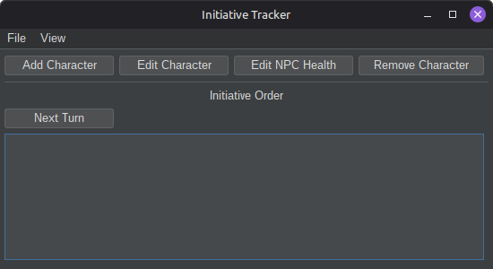

#### 1.2. Active Combat & Turn Order Highlighting
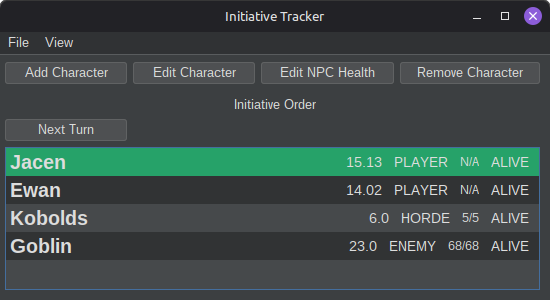

#### 1.3. Theme Showcase
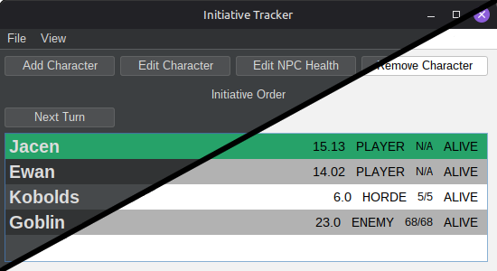

---

### 2. Adding Combatants
#### 2.1. Adding a Player Character
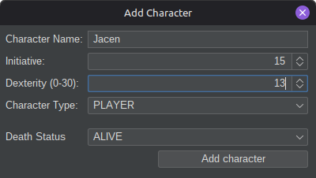

#### 2.2. Adding an Enemy or NPC (Hit Point Configuration)
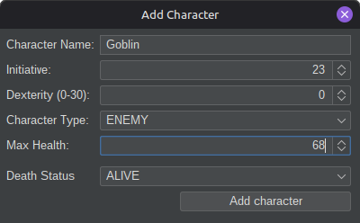

#### 2.3. Configuring a Swarm or Horde Entity
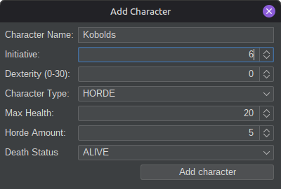

---

### 3. Active Death Saving Throw Controls
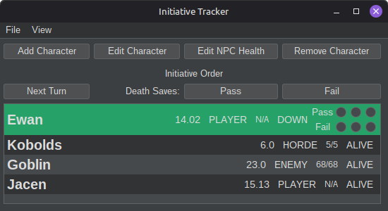

---

### 4. Mid-Combat Adjustments
#### 4.1. Editing Stats Mid-Combat (Initiative, Dexterity, Status)
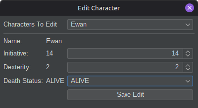

#### 4.2. Applying NPC Damage & Healing (+ / -)
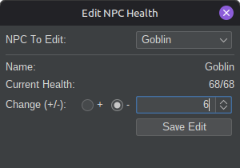

#### 4.3.1. Targeted Removal (Single)
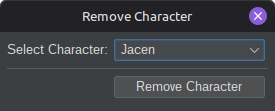

#### 4.3.2. Targeted Removal (Group)
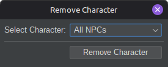

---

### 5. File Persistence & Encounter Storage
#### 5.1. Saving Encounters with Custom Filenames
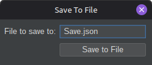

#### 5.2. Browsing & Loading Encounters from Storage
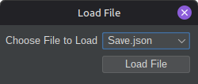

---

## Project Structure

```text
src/main/java/com/c0d3wan/initiativetracker/
├── characters/
│   ├── data/
│   │   ├── CharacterType.java          # Enum for alignment categories (PLAYER, ENEMY, ALLY, HORDE, UNKNOWN)
│   │   ├── DeathStatus.java            # Enum for health states (ALIVE, DOWN, DEAD, UNKNOWN)
│   │   ├── CharacterData.java          # Immutable record snapshot of combatant state
│   ├── Character.java              # Base combatant model with composite initiative math and death saves
│   ├── CharacterManager.java       # Roster collection, stream sorting, and circular turn rotation
│   ├── Horde.java                  # Composite group NPC entity with aggregated health scaling
│   └── NonePlayerCharacter.java    # NPC subclass adding HP tracking, enemy subtypes, and auto-death triggers
├── filemanagement/
│   ├── ConfigManager.java          # Serializes and restores UI theme preferences
│   ├── FileManager.java            # Cross-platform directory routing (Windows, Linux, macOS)
│   └── SaveLoadManager.java        # AES encryption, decryption, and JSON serialization for encounters
├── swingui/
│   ├── AddCharacterMenu.java       # Modal dialog for creating combatants with duplicate name & regex validation
│   ├── CharacterCellRenderer.java  # Custom JList renderer for active turn highlighting and death save pips
│   ├── EditCharacterMenu.java      # Modal dialog for updating initiative, dexterity, and status
│   ├── EditNPCHealth.java          # Modal dialog for bounded damage/healing (-/+) adjustments
│   ├── LoadFileMenu.java           # Modal dialog for browsing and loading saved encounters
│   ├── MainMenu.java               # Primary JFrame window hosting toolbars, buttons, and initiative list
│   ├── RemoveCharacterMenu.java    # Modal dialog for removing characters, NPCs, or specific enemy types
│   ├── SaveAsMenu.java             # Modal dialog for naming and saving new encounter files
│   └── UIManager.java              # Controller synchronizing Swing UI events with the backend manager
└── Main.java                       # Application entry point loading configuration and launching GUI on the EDT
```

---

## Authors
- **[EubiWan](https://github.com/EubiWan)** – UI, Semi-Backend
- **[C0d3-404](https://github.com/c0d3-404)** – Backend, Bridge, Documentation

---

## License
This project is licensed under the **GNU General Public License v3.0** - see the [LICENSE](LICENSE) file for details.
