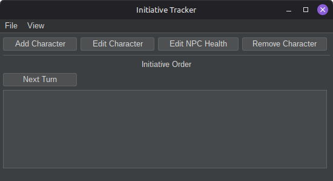
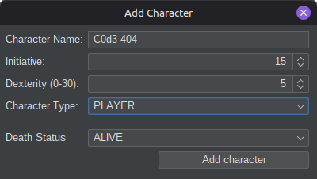
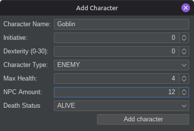
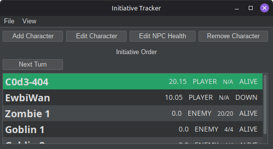
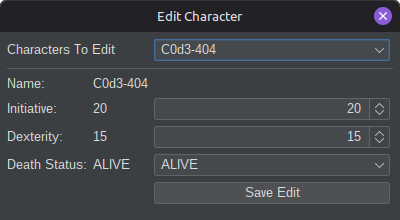
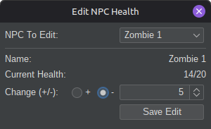
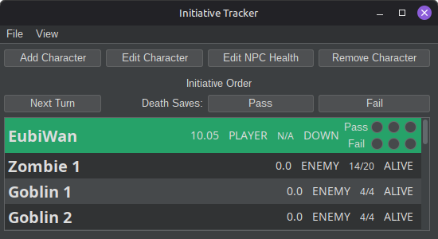
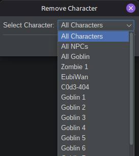

# D&D Initiative Tracker


A desktop combat management and initiative tracking application for D&D. Designed for DMs, it automates turn order, resolves ties, tracks NPC hit points, and manages death saves.

## Table of Contents
- [Installation & Running](#installation--running)
- [Features](#features)
- [Usage Guide](#usage-guide)
- [Project Structure](#project-structure)
- [Authors](#authors)

---

## Installation & Running

### Via Repository

#### Prerequisites
Ensure you have the following installed on your machine:
- **Java Development Kit (JDK):** Version 21 or higher (21 recommended): `java -version`
- **Apache Maven:** `mvn -version`
- **Git:** `git --version`

#### 1. Clone the repository

**Windows:**
```shell
cd C:/Users/YourUsername/Documents/
git clone https://github.com/C0d3Wan/InitiativeTracker
cd C:/Users/YourUsername/Documents/InitiativeTracker/
```

**Linux:**
```bash
cd ~/Documents/
git clone https://github.com/C0d3Wan/InitiativeTracker
cd ./InitiativeTracker/
```

#### 2. Compile and run using Maven

Run directly via Maven:
```bash
mvn clean compile exec:java -Dexec.mainClass="com.c0d3wan.initiativetracker.Main"
```

Or build the package and run it from the `target/` directory:
```bash
mvn clean package
```

### Via Releases
Go to [Releases](https://github.com/EubiWan/InitiativeTracker/releases) and install the latest version for your device.

---

## Features
- **Automatic Initiative & Tie-Breaker Calculation** – Sorts combatants automatically and resolves ties using Dexterity modifiers.
- **Circular Turn Queue & Active Highlighting** – Rotates the active combatant to the top of the list with green turn highlighting.
- **Dynamic Death Saving Throws** – Contextual Pass/Fail controls and visual pip trackers when the active character is downed.
- **NPC Health Management** – Tracks current and max HP for Enemies and Allies with automatic death status transitions at 0 HP.
- **Live Mid-Combat Editing** – Update initiative rolls, Dexterity scores, or life statuses on the fly.
- **Batch Adding & Removal** – Add multiple combatants in one go, or clear out all NPCs/characters at the end of an encounter.
- **Input Validation** – Prevents duplicate names and truncates overly long strings to keep the UI clean.
- **Save/Load** - Ability to save and load the initiative tracker

---

## Usage Guide

### 1. Main Interface (Empty State)


### 2. Adding a Player Character


### 3. Adding an Enemy / NPC (with Max Health)


### 4. Active Combat & Turn Order


### 5. Editing Character Stats Mid-Combat


### 6. Managing NPC Health (Damage & Healing)


### 7. Rolling Death Saving Throws


### 8. Removing Combatants


---

## Project Structure

```text
src/main/java/com/eubi/initiativetracker/
├── characters/
│   ├── Character.java              # Base combatant model with composite initiative math and death saves
│   ├── CharacterManager.java       # Roster collection, stream sorting, and circular turn rotation
│   ├── CharacterType.java          # Enum for alignment categories (PLAYER, ENEMY, ALLY)
│   ├── DeathStatus.java            # Enum for health states (ALIVE, DOWN, DEAD)
│   └── NonePlayerCharacter.java    # NPC/Enemy subclass adding current/max HP and auto-death triggers
├── swingui/
│   ├── AddCharacterMenu.java       # Modal dialog for creating combatants with duplicate name validation
│   ├── CharacterCellRenderer.java  # Custom JList renderer for turn highlighting and death save pips
│   ├── EditCharacterMenu.java      # Modal dialog for updating initiative, dexterity, and status
│   ├── EditNPCHealth.java          # Modal dialog for bounded damage/healing (-/+) adjustments
│   ├── MainMenu.java               # Primary JFrame window hosting toolbars, buttons, and initiative list
│   ├── RemoveCharacterMenu.java    # Modal dialog for removing single characters, NPCs, or all records
│   └── UIManager.java              # Controller synchronizing Swing UI events with the backend manager
└── Main.java                       # Application entry point configuring FlatDarkLaf and launching GUI
```

---

## Authors
- **[EubiWan](https://github.com/EubiWan)** – UI, Semi-Backend
- **[C0d3-404](https://github.com/c0d3-404)** – Backend, Bridge, Documentation